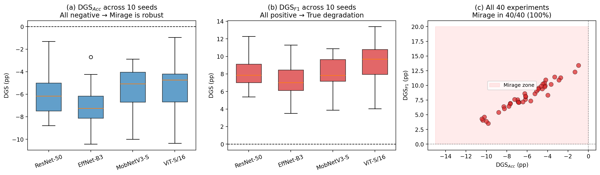
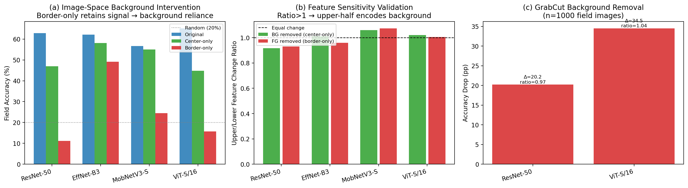
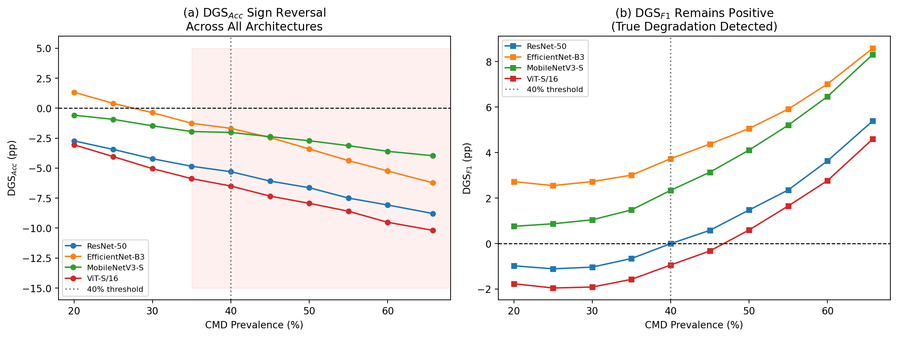
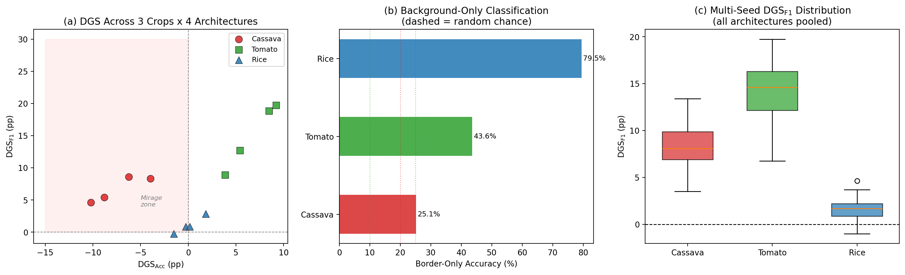
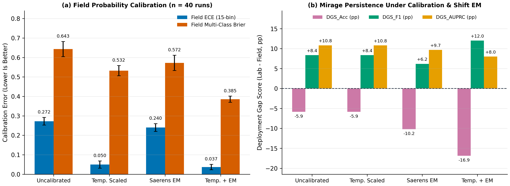
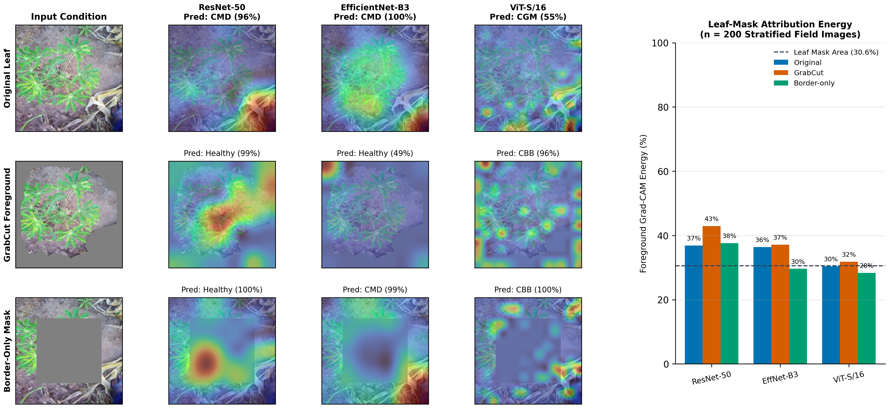
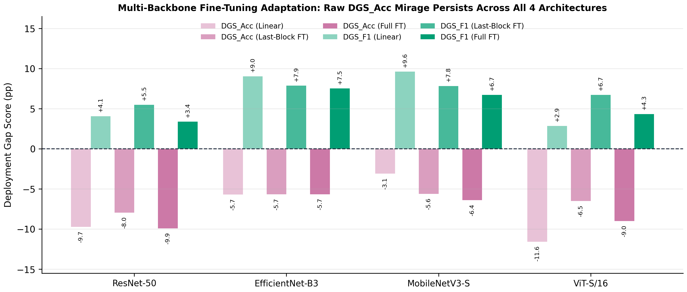

# DGS-Bench: Measuring the Deployment Gap in African Agricultural AI Requires Balanced Metrics

[](https://saaillab.github.io/papers/dgs-bench/)
[](paper/dgs_bench_dli2026.pdf)
[](LICENSE)

**Innocent Nyalala** (IIT Madras Zanzibar; IIT Madras), **Surabhi Gudla** (IIT Madras Zanzibar), **Patrick Vincent Ndowo** (IIT Madras Zanzibar)

Project Page: [saaillab.github.io/dgs-bench/](https://saaillab.github.io/dgs-bench/) | Paper: [`paper/dgs_bench_dli2026.pdf`](paper/dgs_bench_dli2026.pdf) | Poster: [`paper/poster3_camera_ready.pdf`](paper/poster3_camera_ready.pdf)

---

## Overview

Agricultural computer vision classifiers trained on balanced laboratory datasets frequently report moderate linear-probe accuracy near 55%, yet show higher raw accuracy when tested on naturally imbalanced African field collections. Across **40 controlled experiments** (10 random seeds spanning 4 pretrained architectures) on Ugandan smallholder cassava imagery (`n = 21,397`, with `65.8%` Cassava Mosaic Disease prevalence in the field test set), **DGS-Bench** exposes this effect as an **Evaluation Mirage**:

- Raw-accuracy Deployment Gap Score (`DGS_Acc = Acc_L - Acc_F`) is negative in **40/40 experiments** (mean **`-6.00 +/- 2.38 pp`**, `t = -15.8`, `p < 1e-6`), making deployment appear to improve performance.
- Class-balanced Macro-F1 DGS (`DGS_F1 = F1_L - F1_F`) is positive in **40/40 experiments** (mean **`+8.16 +/- 2.34 pp`**, `t = 21.7`, `p < 1e-6`), exposing real minority-class degradation invisible to aggregate accuracy.
- Healthy leaf recall falls from `52.5%` in balanced laboratory tests to `47.7%` in natural field splits for ResNet-50, and Cassava Bacterial Blight (CBB, `5.1%` field share) drops to `28.4%` Average Precision compared with `93.8%` on CMD.



---

## Camera-Ready Results (DLI 2026)

### Dataset Partition (Table 1)

| Split | Images | Classes | Class Distribution |
|---|---:|---:|---|
| Lab train | 1,600 | 5 | Balanced (320 per class) |
| Lab test | 400 | 5 | Balanced (80 per class) |
| Field test | 19,397 | 5 | Natural (CMD 65.8%, Healthy 12.0%, CGM 11.2%, CBSD 10.2%, CBB 5.1%) |

Deterministic split specifications across all 10 seeds (`42..51`) matching `train.csv` SHA-256 `6b81673643552f79295906db2c978b93f30f5c009562c801fe6c4ddd6dab2208` are stored in [`splits/cassava_10seed_splits.json`](splits/cassava_10seed_splits.json) and [`splits/prevalence_sweep_specs.json`](splits/prevalence_sweep_specs.json).

### Multi-Seed & Multi-Metric Contrast (Tables 2 and 3)

| Architecture | Multi-Seed `DGS_Acc` (pp) | Multi-Seed `DGS_F1` (pp) | Field AUROC (%) | Canonical `DGS_BAcc` (pp) | Canonical `DGS_MCC` (pp) | Canonical `DGS_AUPRC` (pp) | Mirage Count |
|---|---:|---:|---:|---:|---:|---:|---:|
| ResNet-50 | `-6.0 +/- 2.2` | `+8.2 +/- 2.0` | 85.0 | `-2.7` | `+5.8` | `+5.7` | 10/10 |
| EfficientNet-B3 | `-7.0 +/- 2.4` | `+7.2 +/- 2.4` | 83.8 | `+1.0` | `+9.5` | `+10.5` | 10/10 |
| MobileNetV3-S | `-5.5 +/- 2.1` | `+8.1 +/- 2.1` | 82.1 | `-0.5` | `+7.6` | `+10.6` | 10/10 |
| ViT-Small/16 | `-5.5 +/- 3.0` | `+9.1 +/- 2.9` | 85.8 | `-3.6` | `+5.4` | `+6.4` | 10/10 |
| **All (`n = 40`)** | **`-6.0 +/- 2.4`** | **`+8.2 +/- 2.3`** | `--` | **`-1.4`** | **`+7.1`** | **`+8.3`** | **40/40** |

Threshold-sensitive balanced metrics (`DGS_F1 = +8.2 pp` across 40 runs, `DGS_AUPRC = +8.3 pp`, `DGS_MCC = +7.1 pp`) agree in sign and magnitude, whereas macro-AUROC (`DGS_AUROC = -2.3 pp`) reverses sign because higher dominant-class confidence on CMD raises one-vs-rest ranking scores without fixing thresholded minority classification (`CBB 28.4%` AP vs. `CMD 93.8%` AP).

### Image-Space Background Intervention & GrabCut Segmentation (Table 4)

| Architecture | Original Field Acc (%) | Center-Only Acc (%) | Border-Only Acc (%) | Background Reliance (vs. 20% chance) | GrabCut (`n = 1,000`) Drop |
|---|---:|---:|---:|---:|---|
| ResNet-50 | 62.8 | 47.0 | 11.2 | `-8.8 pp` | `62.0% -> 41.8%` (`Delta = 20.2 pp`) |
| EfficientNet-B3 | 62.2 | 58.2 | **49.2** | **`+29.2 pp`** | `--` |
| MobileNetV3-S | 56.6 | 55.0 | 24.5 | `+4.5 pp` | `--` |
| ViT-Small/16 | 65.2 | 44.8 | 15.7 | `-4.3 pp` | `63.5% -> 29.0%` (`Delta = 34.5 pp`) |



### Fine-Tuning Amplification & Feature-Space Perturbations (Tables 5 and A1)

| ResNet-50 Regime | Lab Acc (%) | Field Acc (%) | `DGS_Acc` (pp) | `DGS_F1` (pp) | Mirage? |
|---|---:|---:|---:|---:|---|
| Linear probe (frozen) | 54.5 | 63.3 | `-8.8` | `+5.4` | Yes |
| Last-block fine-tuned | 65.5 | 73.2 | `-7.7` | `+5.7` | Yes |
| Full fine-tuned | 69.2 | 77.9 | `-8.6` | `+5.1` | Yes |

Under controlled feature-space perturbations at severity 1.0, background texture disruption imposes the largest accuracy drop across all models (mean `17.0 pp`; ViT-Small/16 `21.3 pp`), ahead of Gaussian noise (`12.4 pp`) and brightness shift (`-0.9 pp`).

### Theoretical Mirage Inequality & Cross-Architecture Onset (Table 8)

Assuming stable class recalls under prior shift (`Acc_F ≈ p * r_1 + (1 - p) * r_bar_{-1}`), raw accuracy reverses sign (`DGS_Acc < 0`) whenever majority prevalence exceeds the closed-form boundary:

```text
p* = (Acc_L - r_bar_{-1}) / (r_1 - r_bar_{-1})
```

Observed onset sweeps across prevalence levels `0.20` to `0.658` match theoretical predictions for all four backbones (`100%` match): MobileNetV3-S enters the mirage zone at `20%` CMD prevalence (`p* = 13.9%`), EfficientNet-B3 at `30%` (`p* = 25.9%`), ResNet-50 at `45%` (`p* = -1.0%`), and ViT-Small/16 at `50%` (`p* = -3.7%`).



### Cross-Dataset Validation Across Three Crops (Table 9)

Applying the same protocol to **PlantVillage Tomato** (`n = 18,160`, 10 classes) and **Rice Leaf Disease** (`n = 5,932`, 4 classes) confirms two joint conditions for the mirage: severe class imbalance (`>30%`) paired with moderate laboratory uncertainty (`<75%` accuracy). When frozen features exceed `90%` laboratory accuracy (Tomato `90.0-92.5%`, Rice `95.6-100.0%`), raw accuracy does not reverse sign (`0/20` multi-seed mirages on Tomato; `3/20` borderline on Rice), although `DGS_F1` (`+8.9` to `+19.7 pp` on Tomato) remains `2x` to `3x` larger than `DGS_Acc`.



---

## Mandatory Reporting Protocol (Algorithm 1)

```python
from dgs_bench import compute_dgs_report

report = compute_dgs_report(
    y_lab_true=y_lab,
    y_lab_prob=probs_lab,
    y_field_true=y_field,
    y_field_prob=probs_field,
    class_names=["CBB", "CBSD", "CGM", "CMD", "Healthy"],
)
print(report.to_markdown())
```

1. Train model `f_theta` strictly on balanced `D_L^train` without leaking `D_F` samples.
2. Evaluate Acc, Macro-F1, Balanced Accuracy, Macro-AUROC, and Macro-AUPRC on balanced `D_L^test` and natural `D_F`.
3. Compute `DGS_F1 = F1_L - F1_F` and `DGS_AUPRC = AUPRC_L - AUPRC_F`.
4. Issue `WARNING: report DGS_F1 as primary metric` whenever `|D_F majority class| > 0.30 * |D_F|`.
5. Report the full per-class confusion matrix and class prevalence vector alongside aggregate metrics.

---

## v1.1 Extension Experiments

[`experiments/run_v11_extensions.py`](experiments/run_v11_extensions.py) extends the DLI 2026 camera-ready suite across three empirical diagnostics on all 21,397 Cassava images.

### 1. 10-Seed Calibration & Saerens EM Prior-Shift Adaptation (`n = 40` Runs)

To test whether post hoc calibration or label-shift expectation maximization eliminates the Evaluation Mirage, we fit out-of-fold Temperature Scaling on each balanced training fold and apply Saerens EM against natural field test sets (`true CMD prior = 65.77%`).

| Regime (`All, n = 40`) | Est. CMD Prior (%) | Field ECE | Field Brier | Field Acc (%) | Field Macro-F1 (%) | `DGS_Acc` (pp) | `DGS_F1` (pp) |
|---|---:|---:|---:|---:|---:|---:|---:|
| Uncalibrated | `20.00 +/- 0.00` | `0.2721 +/- 0.0197` | `0.6429 +/- 0.0391` | `60.79` | `46.55` | `-5.86` | `+8.36` |
| TempScaled | `20.00 +/- 0.00` | `0.0497 +/- 0.0185` | `0.5322 +/- 0.0261` | `60.79` | `46.55` | `-5.86` | `+8.36` |
| Saerens EM (uncal.) | `51.87 +/- 2.00` | `0.2399 +/- 0.0201` | `0.5722 +/- 0.0393` | `65.13` | `48.72` | `-10.19` | `+6.19` |
| TempScaled + Saerens EM | `68.02 +/- 3.58` | **`0.0371 +/- 0.0137`** | **`0.3853 +/- 0.0158`** | `71.80` | `42.91` | **`-16.87`** | **`+12.01`** |

Temperature scaling cuts field ECE by `81.7%` (`0.2721 -> 0.0497`) without altering class order (`DGS_Acc = -5.86 pp`). Combining calibrated probabilities with Saerens EM recovers the true field CMD prevalence (`68.02% +/- 3.58%` vs. `65.77%`) and lowers ECE to `0.0371` (`86.4%` drop), yet deepens minority-class suppression (`Fld BAcc` drops from `54.49%` to `39.30%`), widening the raw accuracy illusion to `-16.87 pp` and enlarging `DGS_F1` to `+12.01 pp`.



### 2. Grad-CAM & ViT Spatial Attribution Before and After Background Intervention (`n = 200`)

Across `n = 200` stratified field images (`40` per class with valid GrabCut leaf masks, mean leaf area `30.59%`, outer 40% border area `63.14%`), positive Grad-CAM and ViT patch-gradient energy stays heavily outside the foliage mask (`56.29%` to `63.78%` on the outer border in original images).

| Architecture | Condition (`n = 200`) | Accuracy (%) | CMD Pred. Rate (%) | Foreground Leaf Energy (%) | Outer Border Energy (%) |
|---|---|---:|---:|---:|---:|
| ResNet-50 | Original | `56.5` | `17.5` | `36.84` | `56.29` |
| ResNet-50 | GrabCut | `43.5` | `14.0` | `42.91` | `49.96` |
| ResNet-50 | Border-only | `24.0` | `2.0` | `37.64` | `53.11` |
| EfficientNet-B3 | Original | `53.5` | `16.5` | `36.40` | `56.34` |
| EfficientNet-B3 | GrabCut | `37.0` | `12.5` | `37.15` | `56.01` |
| EfficientNet-B3 | Border-only | **`40.0`** | **`16.5`** | `29.61` | **`66.00`** |
| ViT-S/16 | Original | `57.0` | `17.0` | `30.39` | `63.78` |
| ViT-S/16 | GrabCut | `32.0` | `1.0` | `31.80` | `63.42` |
| ViT-S/16 | Border-only | `40.5` | `5.5` | `28.37` | `65.80` |

When the central leaf region is masked out (`Border-only`), `EfficientNet-B3` retains `40.0%` accuracy and the exact `16.5%` CMD prediction rate observed on unmasked photos by shifting `66.00%` of its Grad-CAM energy onto outer border soil and foliage clutter.



### 3. Multi-Backbone Fine-Tuning Extension (All 4 Architectures, 12 Epochs)

Extending Table 5 across every tested backbone confirms that adaptation raises absolute accuracy (`ViT-S/16` reaches `79.00%` field accuracy) without removing the Evaluation Mirage (`12/12` runs retain negative `DGS_Acc` and positive `DGS_F1`).

| Architecture | Regime | Lab Acc (%) | Field Acc (%) | `DGS_Acc` (pp) | Lab F1 (%) | Field F1 (%) | `DGS_F1` (pp) | Mirage? |
|---|---|---:|---:|---:|---:|---:|---:|---|
| ResNet-50 | Linear Probe | `52.75` | `62.49` | `-9.74` | `52.36` | `48.30` | `+4.06` | Yes |
| ResNet-50 | Last-Block FT | `63.75` | `71.70` | `-7.95` | `63.62` | `58.14` | `+5.49` | Yes |
| ResNet-50 | Full FT | `64.00` | `73.92` | `-9.92` | `63.98` | `60.61` | `+3.37` | Yes |
| EfficientNet-B3 | Linear Probe | `55.75` | `61.46` | `-5.71` | `55.53` | `46.50` | `+9.03` | Yes |
| EfficientNet-B3 | Last-Block FT | `50.00` | `55.68` | `-5.68` | `50.14` | `42.28` | `+7.86` | Yes |
| EfficientNet-B3 | Full FT | `51.75` | `57.41` | `-5.66` | `51.78` | `44.26` | `+7.52` | Yes |
| MobileNetV3-S | Linear Probe | `53.25` | `56.35` | `-3.10` | `53.31` | `43.70` | `+9.61` | Yes |
| MobileNetV3-S | Last-Block FT | `58.00` | `63.61` | `-5.61` | `57.84` | `50.02` | `+7.82` | Yes |
| MobileNetV3-S | Full FT | `60.00` | `66.40` | `-6.40` | `59.98` | `53.26` | `+6.72` | Yes |
| ViT-S/16 | Linear Probe | `52.25` | `63.84` | `-11.59` | `52.42` | `49.57` | `+2.85` | Yes |
| ViT-S/16 | Last-Block FT | `66.50` | `73.01` | `-6.51` | `66.33` | `59.61` | `+6.72` | Yes |
| ViT-S/16 | Full FT | `70.00` | `79.00` | `-9.00` | `70.02` | `65.69` | `+4.33` | Yes |



---

## Repository Structure & Quick Verification

```text
dgs-bench/
├── dgs_bench/          # Algorithm 1 protocol, metrics, calibration, Saerens EM, split helpers, CLI
├── splits/             # Deterministic 10-seed Cassava split JSONs and prevalence sweep specs
├── experiments/        # DGS-Bench v1.1 GPU scripts (calibration, Grad-CAM, multi-backbone FT)
├── notebooks/          # Reproducible Kaggle/Colab notebooks from the DLI 2026 camera-ready suite
├── results/            # Verified camera-ready CSV/JSON outputs and v1.1 extension logs
├── figures/            # Publication PNG figures
├── paper/              # Camera-ready PDF and poster PDF
└── tests/              # Pytest unit suite verifying Algorithm 1 and closed-form p* parity
```

Run tests and theoretical parity verification from the repository root:

```bash
pip install -e .[dev]
pytest -q
python -m dgs_bench.cli --demo-verify --results-dir results
```

---

## Citation

```bibtex
@inproceedings{nyalala2026dgsbench,
  title={DGS-Bench: Measuring the Deployment Gap in African Agricultural AI Requires Balanced Metrics: A Cassava Case Study},
  author={Nyalala, Innocent and Gudla, Surabhi and Ndowo, Patrick Vincent},
  booktitle={Deep Learning Indaba 2026},
  address={Lagos, Nigeria},
  year={2026},
  month={August},
  note={Best Poster Award; 18 of 114 accepted (15.79\% acceptance rate)}
}
```

## License

Licensed under **Creative Commons Attribution-NonCommercial 4.0 International (`CC BY-NC 4.0`)**. See [`LICENSE`](LICENSE). Commercial inquiries: `innocent@iitmz.ac.in`.
