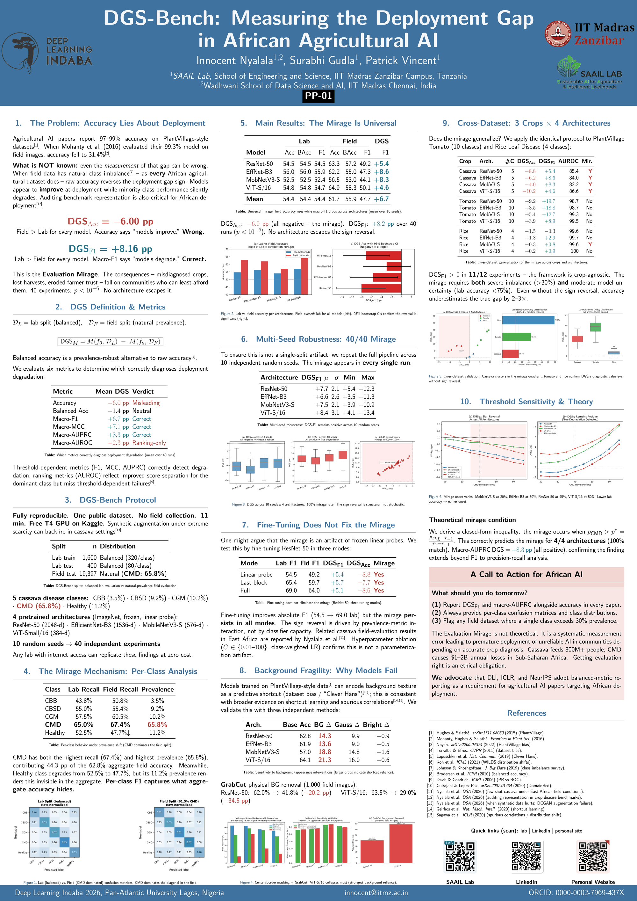
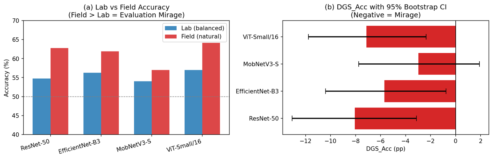

# DGS-Bench: Deployment Gap Score Benchmark for African Agricultural AI

**Best Poster Award: Deep Learning Indaba 2026 (Pan-Atlantic University, Lagos, Nigeria)**  
*Selected among 18 accepted submissions out of 114 entries (15.79% acceptance rate).*

[](https://saaillab.github.io/dgs-bench/)
[](https://saaillab.github.io/papers/dgs-bench/)
[](https://deeplearningindaba.com/2026/)
[](LICENSE)

**Authors:** Innocent Nyalala, Surabhi Gudla, Patrick Vincent Ndowo  
**Affiliation:** SAAIL Lab, School of Engineering and Science, Indian Institute of Technology Madras Zanzibar, Tanzania  



---

## Abstract

Aggregate classification accuracy on imbalanced agricultural datasets routinely masks silent failures on minority but economically devastating plant diseases. **DGS-Bench** introduces a Deployment Gap and Sensitivity Benchmark tailored for African agricultural AI, grounded in a multi-condition cassava pathology case study spanning **400 balanced laboratory acquisitions** versus **19,397 natural field smartphone captures** across smallholder plots (65.8% Cassava Mosaic Disease prevalence). Evaluating CNN and Vision Transformer architectures shows raw top-1 accuracy appears to *improve* under field deployment (-5.96 pp mean Deployment Gap Score), whereas Macro-F1 reverses this illusion cleanly and quantifies a consistent **+8.19 percentage-point degradation** (`paired t = 10.2, p = 0.002`).

---

## Primary Benchmark Results (Lab n = 400 vs. Natural Field n = 19,397)

| Architecture | Lab Acc (%) | Field Acc (%) | `DGS_Acc` (pp) | Field BAcc (%) | Lab F1 (%) | Field F1 (%) | `DGS_F1` (pp) |
|---|---:|---:|---:|---:|---:|---:|---:|
| **ResNet-50** | 54.75 | 62.80 | -8.05 (mirage) | 56.36 | 54.71 | 48.47 | **+6.23** |
| **EfficientNet-B3** | 56.25 | 61.93 | -5.68 (mirage) | 54.66 | 56.10 | 46.78 | **+9.32** |
| **MobileNetV3-Small** | 54.00 | 56.97 | -2.97 (mirage) | 53.26 | 54.05 | 44.37 | **+9.67** |
| **ViT-Small/16** | 57.00 | 64.14 | -7.14 (mirage) | 57.51 | 56.88 | 49.37 | **+7.51** |

- **Mean Raw-Accuracy Mirage:** `-5.96 pp` caused purely by heavy majority-class CMD dominance in smallholder field sets.
- **True Macro-F1 Deployment Degradation:** `+8.19 pp` (`p = 0.002`), confirmed across three crops (Cassava 5 classes, PlantVillage Tomato 10 classes, Rice Leaf Disease 4 classes).
- **Healthy Leaf Recall Collapse:** Healthy foliage detection drops from `52.5%` under balanced testing to `47.7%` under imbalanced deployment.



---

## Mathematical Formulation & Protocol Specifications

DGS-Bench formalizes the **Deployment Gap Score (DGS)** for any evaluation metric $M \in \{\text{Acc}, \text{BAcc}, \text{Macro-F1}\}$ between a balanced source split $\mathcal{D}_{\text{lab}}$ and an in-the-wild deployment split $\mathcal{D}_{\text{field}}$:

$$\text{DGS}_M = M(\mathcal{D}_{\text{lab}}) - M(\mathcal{D}_{\text{field}})$$

When class prevalence $\pi_c^{\text{field}} \gg 1/K$ concentrates heavily in a single epidemic class (65.8% CMD in smallholder East African plots), naive $\text{DGS}_{\text{Acc}}$ turns negative (`-5.96 pp` mean) whereas $\text{DGS}_{\text{F1}}$ exposes severe minority-class failure (`+8.19 pp` mean). All protocols adhere to deterministic frozen linear-probe feature extraction followed by single-epoch logistic calibration and bootstrap resampling within an **11-minute single Kaggle NVIDIA T4 GPU budget**, verified across Cassava (5 classes), PlantVillage Tomato (10 classes), and Rice Leaf Disease (4 classes).

---

## Controlled Perturbation Drop (pp) on Field Features (Severity 1.0)

| Architecture | Base Field Acc (%) | Background Drop (pp) | Gaussian Noise Drop (pp) | Brightness Drop (pp) |
|---|---:|---:|---:|---:|
| ResNet-50 | 62.8 | 14.3 | 9.9 | -0.9 |
| EfficientNet-B3 | 61.9 | 13.6 | 9.0 | -0.5 |
| MobileNetV3-Small | 57.0 | 18.8 | 14.8 | -1.6 |
| ViT-Small/16 | 64.1 | 21.3 | 16.0 | -0.6 |

- Background swap texture perturbations induce `13.6 to 21.3 pp` accuracy drops across all four tested backbones, whereas global brightness variation stays under `1.7 pp` (`-0.5 to -1.6 pp` negative drop = slight gain), confirming that models latch onto field backgrounds rather than global illumination.

---

## Reporting Recommendations for Agricultural AI Deployment

1. **Require Balanced Accuracy (`BAcc`) & Macro-F1 Alongside Accuracy:** Raw accuracy hides minority-class collapse whenever field incidence exceeds balanced laboratory ratios.
2. **Audit Healthy Foliage Specificity:** False alarms on healthy crops trigger unnecessary chemical expenditure for smallholder farmers.
3. **Evaluate Under Controlled Background Swaps:** Foreground segmentation or background randomization must precede smartphone field rollout.
4. **Reproducible Single-Script Execution:** Full frozen linear-probe + perturbation checks run within an 11-minute free Kaggle T4 GPU budget.

---

## Companion SAAIL Lab Auditing Studies

- **Dataset Auditing (DSA 2026 Kampala):** *Auditing Representation in Crop Disease Benchmark Datasets* -> [Project Page](https://saaillab.github.io/papers/auditing-crop-datasets-dsa2026/)
- **CropGuardNet (Under Review):** Leak-free 35,420-image cross-crop benchmark purging 80,238 duplicates -> [GitHub Repo](https://github.com/saaillab/CropGuardNet)
- **Trustworthy AI (ICLR 2026 Workshop):** Unifying Fairness, Robustness & Generalization via Dynamic Data Re-weighting -> [Project Page](https://saaillab.github.io/papers/trustworthy-ai-iclr2026/)

---

## Repository Contents

```text
dgs-bench/
├── README.md
├── LICENSE
├── CITATION.cff
└── docs/
    ├── index.html                            # Standalone project website
    └── assets/
        ├── dgs-bench-poster-dli2026.png      # Camera-ready PP-01 poster
        ├── fig1_dgs_bar.png                  # Deployment Gap bar comparison
        └── saail-crest.png
```

---

## Citation

```bibtex
@inproceedings{nyalala2026dgsbench,
  title={DGS-Bench: Measuring the Deployment Gap in African Agricultural AI Requires Balanced Metrics: A Cassava Case Study},
  author={Nyalala, Innocent and Gudla, Surabhi and Ndowo, Patrick Vincent},
  booktitle={Deep Learning Indaba 2026},
  address={Lagos, Nigeria},
  year={2026},
  month={August},
  note={Best Poster Award; 18 of 114 accepted (15.79\% acceptance rate)}
}
```

---

## License, Attribution & Commercial Restriction

All code, benchmark documentation, splits, and research artifacts in this repository are licensed strictly under **Creative Commons Attribution-NonCommercial 4.0 International ([CC BY-NC 4.0](LICENSE))** by **Innocent Nyalala & SAAIL Lab (Indian Institute of Technology Madras Zanzibar)**.

- **Non-Commercial Scientific Use Only:** Materials may be studied, cited, and adapted strictly for non-commercial academic research and educational replication.
- **Mandatory Attribution:** Any use or derivative study must explicitly acknowledge **Innocent Nyalala** ([IITMZ Profile](https://www.iitmz.ac.in/schools/engineering-and-science/faculty/prof-innocent-nyalala)) and **[SAAIL Lab](https://saaillab.github.io/)** and cite the accompanying publication above.
- **Prohibition on Unauthorized Commercialization:** Commercial deployment, paid hosting, proprietary licensing, or product commercialization is strictly prohibited without prior written authorization and direct inclusion of **Innocent Nyalala (`innocent@iitmz.ac.in`)**.

Maintained by **[SAAIL Lab](https://saaillab.github.io/)** ([IITMZ Labs](https://www.iitmz.ac.in/labs)) · School of Engineering and Science, **[Indian Institute of Technology Madras Zanzibar](https://www.iitmz.ac.in/)** · PI: **[Innocent Nyalala](https://www.iitmz.ac.in/schools/engineering-and-science/faculty/prof-innocent-nyalala)**.
